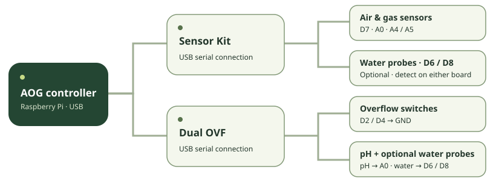

# AOG · Grow observatory

A Raspberry Pi controller for observing a grow system and controlling its equipment. AOG v2 combines a local HTTPS dashboard, air and water sensor history, pH calibration, cameras, schedules, and four assignable relay outputs.



## Dashboard

- **Overview:** air and water temperatures, air quality, pH history, overflow status, and equipment.
- **Connections:** Arduino identification, individual sensor health, pin maps, raw readings, RAM buffer status, and firmware management.
- **Sensor history:** eight metrics with 1-hour, 6-hour, 24-hour, and 7-day views. Water probes keep stable D6/D8 history keys.
- **Reports:** full-resolution CSV/JSON and printable HTML reports, including both water temperatures.
- **Equipment:** independent relays, lighting and watering schedules, configurable overflow stops, and Stop all.

The interface uses local assets and works on desktop and mobile. A reporting Arduino and a physically verified sensor are distinct states. Open overflow contacts can mean high water **or** a disconnected wire; analog pH/gas readings cannot prove physical connection.

## Build and run

Use Rust 1.89 or newer on Raspberry Pi OS / Debian. From the repository root:

```sh
sh setup.sh
cargo build --locked --release -j1
sudo install -m 755 target/release/aog /usr/local/bin/aog-v2.new
sudo mv /usr/local/bin/aog-v2.new /usr/local/bin/aog-v2
sudo install -m 644 deploy/aog-v2.service /etc/systemd/system/aog-v2.service
sudo systemctl daemon-reload
sudo systemctl enable aog-v2
sudo systemctl restart aog-v2
```

Open `https://<pi-address>:8443` and sign in as `admin` using the installation password. Existing settings, passwords, certificates, and recorded data remain in `/opt/aog`. See [controller operation and password recovery](docs/controller.md) and [network configuration](SECURITY.md).

The build automatically embeds current `www/` assets and `firmware/package/`. Rebuilding and installing the controller also installs its firmware package.

## Arduino firmware and water probes

[Sensor Kit](firmware/sensor-kit/sensor-kit.ino) and [Dual OVF](firmware/dual-ovf/dual-ovf.ino) include Nano, Nano old-bootloader, and Uno ATmega328P binaries. Install upload tools on the Pi:

```sh
bash deploy/install-firmware-tools.sh
```

Open **Connections → Firmware**, select the identified Arduino and its actual board profile. AOG pauses schedules, verifies outputs are off, drains supported RAM logs, flashes the checksum-verified package, and waits for the new version to reconnect. Schedules remain paused afterward. Installing AOG or the tools does not flash boards.

The installed three-wire water probes are **not yet identified**. Firmware detects externally powered DS18B20 family `0x28` probes on **D6 and D8 on either Arduino**, verifies CRCs, and exposes each source board and ROM. It does not assume tank assignments. Name and bind probes after identifying them. [Wiring and troubleshooting](docs/wiring.md).

Each Arduino retains **24 one-minute records in RAM**. The Pi acknowledges a record only after syncing it to disk. Deduplicated replays feed environmental/water history and the pH chart. Original timestamps, raw fields, boot IDs, and sequences can be downloaded from Connections. RAM does not survive resets, flashing, or power loss. A full ring replaces its oldest record and reports drops. USB hardware may reset a board during a Pi reboot even when normal service reconnects preserve it. [Protocol and recovery](docs/firmware-protocol.md).

## Repository

```text
src/                 Rust v2 controller
www/                 Dashboard, local fonts, and vector artwork
firmware/            Arduino sources, build script, tests, and release package
deploy/              systemd service and upload-tool installer
tests/               Backend and browser regression tests
docs/                Operation, wiring, and protocol documentation
```

The Python v1 application, old measurements/media, unused web template, and obsolete notes are removed from the current tree. Previous versions remain in Git history. On-device history schemas remain readable; repository cleanup does not erase runtime data.

[Testing](TESTING.md) · [Firmware builds](firmware/README.md) · [Publishing instructions](docs/publishing.md) · [Existing GitHub repository](https://github.com/PixelCoda/AOG) · [Releases](https://github.com/PixelCoda/AOG/releases)
