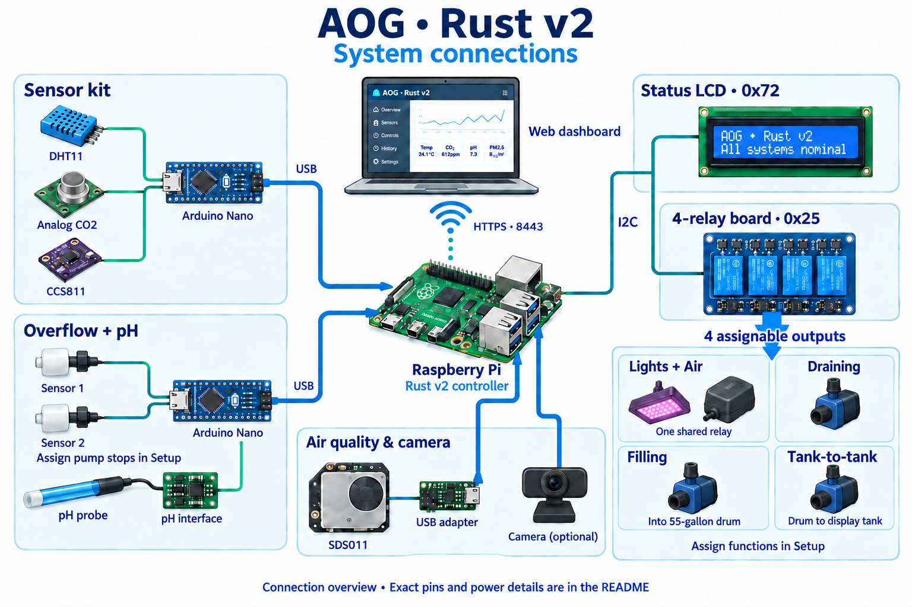
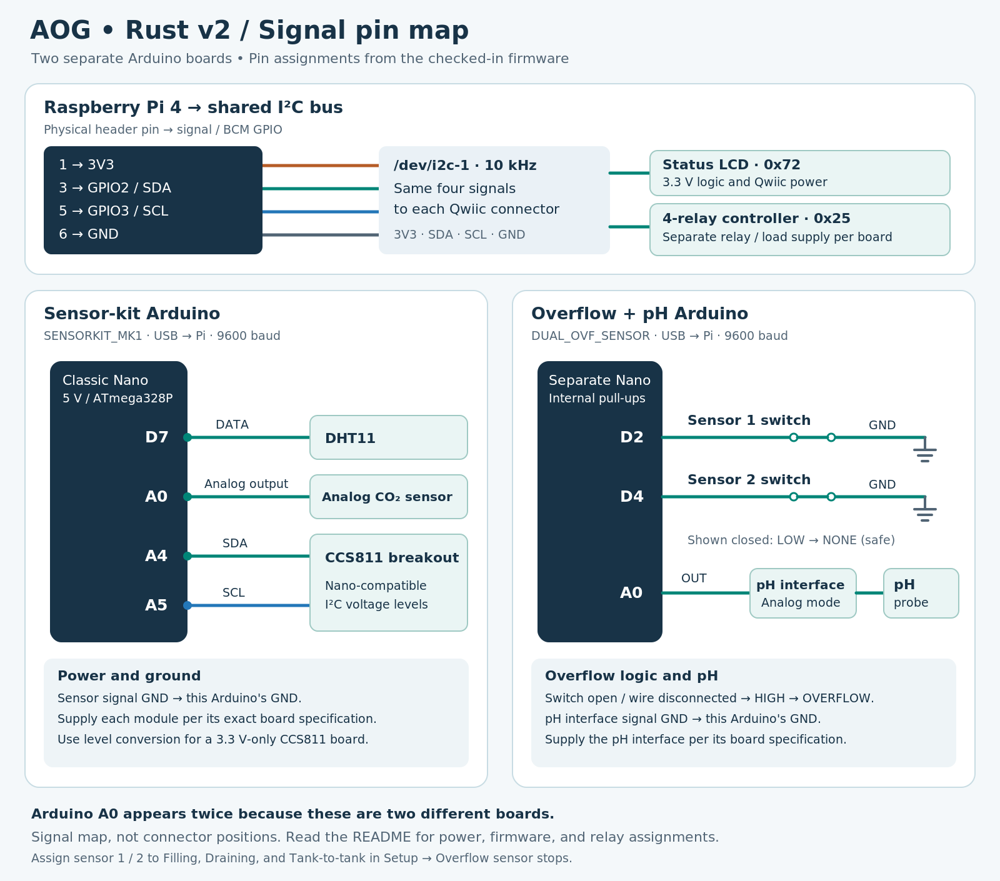

# A.O.G. (Algae Oxygen Reactor)

CO2 is a dangerous indoor/outdoor air pollutant. A.O.G. uses blue-green algae to convert CO2 into Oxygen.


When I first activated the A.O.G....my average indoor CO2 levels were 1000-2000ppm+.  
After 6+ months of use my indoor CO2 level averages between 400-600ppm. 

This project is licensed under the MIT license so that individuals and corporations can make/modify/sell A.O.G. without any restrictions. 

Prototype MK1 build pictures and videos can be found in the media folder. 

A historical parts list can be found in [BUILD.md](BUILD.md). For the current
Rust v2 installation, use the connections and pin mappings below.

## Rust v2 on Raspberry Pi

The [Rust v2 project](src/src-v2-rust-alpha/README.md) provides the web dashboard,
pH history and calibration, CO₂/TVOC/particulate/temperature/humidity history,
live ribbon-camera and USB-webcam views, air-quality exports and reports,
lighting and watering schedules, four configurable
relay outputs, and admin password changes. Open `https://<device-ip>:8443/` on
the same network. Both web services bind to `0.0.0.0` by default; the dashboard
uses a self-signed HTTPS certificate.

Open **Sensor history** for CO₂, TVOC, PM2.5, PM10, temperature, and humidity
charts with 1-hour, 6-hour, 24-hour, and 7-day views. The Pi records every minute
and keeps up to seven days across restarts, even when the browser is closed.
Each chart shows the latest recorded value and the selected period's minimum,
average, and maximum. Collection begins when this version is installed;
missing or stale readings appear as gaps.

Open **Cameras** to view the ribbon camera and USB webcam together. Views start
on demand, support pause and full screen, and use the existing dashboard login.
Install `ffmpeg` and `rpicam-apps-lite` for capture; see the
[camera setup instructions](src/src-v2-rust-alpha/README.md#cameras).

**Reports & exports** provides full recorded data as CSV/JSON and polished HTML
reports with current readings, summaries, coverage, and six trend charts. Choose
a time range, add notes, and use **Print / Save as PDF** in the report. Custom
periods and current-only snapshots are supported; retained history is seven days.

pH calibration updates live readings and charts immediately. One buffer provides
**1-point normalization**; add a second distinct buffer for slope calibration.
Saved points can be removed or replaced in **Setup → pH calibration**. Output
cards each have one button that switches between **Start** and **Stop** as the
relay state changes. Pages refresh after interactions and when you return to them.

See the Rust v2 README for [installation](src/src-v2-rust-alpha/README.md#building-on-debian-ubuntu-or-raspberry-pi-os),
[relay assignments](src/src-v2-rust-alpha/README.md#assign-the-four-relays), and
[password recovery](src/src-v2-rust-alpha/README.md#reset-a-forgotten-admin-password).

## Component connections



The Raspberry Pi runs AOG. Two **separate Arduino boards** report sensor data
over USB serial: `SENSORKIT_MK1` for air measurements and `DUAL_OVF_SENSOR` for
the two overflow switches and pH. The SDS011 uses its own USB serial adapter.
The LCD and relay board share the Pi's I²C bus. Optional cameras connect through
the Pi's CSI ribbon connector and USB. Rust v2 streams both through the dashboard;
USB capture supports raw YUYV as well as JPEG-capable webcams.

The drawings show signal and control connections. Sensor supply requirements
depend on the actual breakout board; relay load power is separate from the
Pi's GPIO and Qwiic power. The pin tables below follow the checked-in firmware,
which may differ from a sketch previously flashed onto a device.

## Pin mapping



[Download PNG](media/diagrams/aog-pin-map.png) · [Editable SVG](media/diagrams/aog-pin-map.svg)

**Arduino `D…` and `A…` labels refer to pins on that Arduino, not Pi GPIO pins.**
The Arduino wiring below assumes a classic 5 V Nano / ATmega328P; the sensor-kit
sketch uses a 5 V ADC reference in its voltage calculation. Check other board
variants before using this map. The classic Nano exposes SDA on A4 and SCL on
A5. See the [official Nano pinout](https://docs.arduino.cc/resources/pinouts/A000005-full-pinout.pdf).

### Sensor kit — `SENSORKIT_MK1`

Firmware: [`sensorkit.ino`](src/src-v2-rust-alpha/sensorkit/sensorkit.ino).

| Component connection | Sensor-kit Arduino pin | Firmware behavior |
| --- | --- | --- |
| DHT11 data / signal | **D7** | Temperature (`TEMP`) and humidity (`HUM`) |
| Analog infrared CO₂ sensor analog output | **A0** | Analog CO₂ measurement; use the analog output, not PWM or UART |
| CCS811 SDA | **A4 / SDA** | I²C air-quality sensor |
| CCS811 SCL | **A5 / SCL** | I²C clock |
| Sensor signal grounds | **GND** | Common reference with this Arduino |
| Arduino USB connector | **Pi USB port** | `9600` baud; framed `SENSORKIT_MK1` reports |

Power each module from the supply specified for its exact board, with signal
ground connected to this Arduino. A 5 V Nano needs a compatible CCS811 breakout
or appropriate level conversion for a 3.3 V-only breakout; the CCS811 chip name
alone does not identify the board's voltage support. For example, DFRobot's
[SEN0318 breakout](https://wiki.dfrobot.com/Gravity%3A%20CCS811%20Air%20Quality%20Sensor%20SKU%3A%20SEN0318)
specifies a 3.3–5.5 V supply.

The sketch waits for CCS811 initialization before reporting. It combines the
CCS811 CO₂-equivalent reading with the analog CO₂ reading when available, so
its `CO2` field is a combined estimate. The `T1_OVF`/`T2_OVF` definitions in this
sketch are unused: **wire the overflow switches to the second Arduino below**.

### Overflow and pH kit — `DUAL_OVF_SENSOR`

Firmware: [`ovf.ino`](src/src-v2-rust-alpha/sensorovfkit/ovf/ovf.ino).

| Component connection | Overflow/pH Arduino pin | Firmware behavior |
| --- | --- | --- |
| Tank 1 overflow switch, one lead | **D2** | `T1_OVF`, input with internal pull-up |
| Tank 1 overflow switch, other lead | **GND** | Switch closes to ground in the safe state |
| Tank 2 overflow switch, one lead | **D4** | `T2_OVF`, input with internal pull-up |
| Tank 2 overflow switch, other lead | **GND** | Switch closes to ground in the safe state |
| Analog pH interface board signal output | **A0** | `Gravity_pH(A0)`; reports `PH` |
| pH interface board signal ground | **GND** | Common reference with this Arduino |
| pH probe | **pH interface board's probe connector** | The probe needs its interface board before A0 |
| Arduino USB connector | **Pi USB port** | Checked-in firmware: `9600` baud; `DUAL_OVF_SENSOR` reports |

The switches are dry contacts between their input and GND. Mount/orient each
float so that a safe water level closes the contact and overflow opens it:

| Contact state | Input level | Report | Water-pump permission |
| --- | --- | --- | --- |
| Closed to GND | LOW | `NONE` | Permits pumps assigned to this sensor, subject to other checks |
| Open, including a disconnected wire | HIGH from pull-up | `OVERFLOW` | Blocks and stops pumps assigned to this sensor |

Missing, invalid, or stale selected readings also block their assigned pumps.
Select the sensor-to-pump rules under **Setup → Overflow sensor stops**; both
sensors protect all three water-pump functions by default. The pH A0 above belongs
to the **overflow/pH Arduino**; the CO₂ A0 belongs to the **sensor-kit Arduino**.
They are separate analog inputs on separate boards.

The sketch targets the Atlas Scientific Gravity analog pH interface and its
`ph_grav.h` library. Connect probe → pH interface → A0, and supply that interface
according to its board documentation. Atlas provides the
[Gravity pH datasheet](https://atlas-scientific.com/files/Gravity-pH-datasheet.pdf)
and [Arduino library instructions](https://files.atlas-scientific.com/gravity-pH-ardunio-code.pdf).
`USE_PULSE_OUT` is disabled in the checked-in sketch; the optional isolator/pulse
configuration requires the matching library, wiring, and recalibration.
Dashboard calibration is applied in Rust; it does not send `CAL,…` commands to
this sketch.

Both sketches currently use `9600` baud. Rust v2 also discovers legacy `1200`
baud firmware. USB port numbers can change after reconnecting, so identify the
boards by their `DEVICE_ID`, not a fixed `/dev/ttyUSB0` assignment. The serialized
Rust `sensor_kit_config` pin fields do **not** reprogram the Arduinos; pin changes
require editing and uploading the corresponding sketch.

### Raspberry Pi — LCD and four-relay board

Use `/dev/i2c-1`. Both boards share SDA, SCL, and logic ground; Qwiic logic is
3.3 V. Physical header numbers below follow the
[Raspberry Pi 4 schematic](https://datasheets.raspberrypi.com/rpi4/raspberry-pi-4-reduced-schematics.pdf).

| Pi physical header pin | Pi signal / BCM GPIO | Qwiic / board connection |
| --- | --- | --- |
| **1** | **3.3 V** | Qwiic 3V3 for compatible LCD and relay logic |
| **3** | **GPIO2 / SDA1** | SDA on both boards |
| **5** | **GPIO3 / SCL1** | SCL on both boards |
| **6** | **GND** | Logic GND on both boards |

AOG expects the SerLCD at **`0x72`** and the quad relay controller at **`0x25`**.
These are AOG's configured addresses, not a promise of factory defaults on a
replacement board. Relay coil/load power must follow the actual board's
requirements. SparkFun's mechanical Qwiic Quad Relay uses separate 3.3 V logic
and 5 V relay power systems, with supply/jumper details that depend on its
revision. See the [quad relay hookup guide](https://learn.sparkfun.com/tutorials/qwiic-quad-relay-hookup-guide).
The [SerLCD guide](https://learn.sparkfun.com/tutorials/avr-based-serial-enabled-lcds-hookup-guide/all)
specifies 3.3 V data signals and Qwiic power; do not put 5 V on the Pi's I²C bus.

Enable I²C and use the documented 10 kHz bus setting for this installation;
see [Rust v2 I²C setup](src/src-v2-rust-alpha/README.md#i²c-display-and-relay-board).
The LCD updates only changed text, leaving the IP and labels in place. Its
human-readable status uses a green backlight for `Ok`, yellow for sensor
malfunctions/warnings, and red for active errors. Long status messages scroll
only within the status row; the same link documents the messages and codes.
There are no separate Pi GPIO control pins for relay channels 1–4 in this setup.
Use suitably rated, normally-open load contacts when an unpowered relay must
leave the equipment off; the diagrams do not specify mains terminal wiring.

### Four relay functions

The board's channel numbers are physical **1–4**. In the dashboard's
**Setup → Setup & relay assignments**, assign **Lights + Air**, **Draining**,
**Filling**, **Tank-to-tank**, or **Unassigned** to each channel to match the equipment wiring.
Each function can be used once. There are no permanently fixed function pins.

| Physical relay | New-installation default | Function |
| --- | --- | --- |
| 1 | Lights + Air | Lights and the air pump switch together on one relay |
| 2 | Draining | Drain pump |
| 3 | Filling | Add water to the 55-gallon drum |
| 4 | Tank-to-tank | Pump water from the 55-gallon drum to the display tank above |

Use **Stop all** before changing assignments. A successful assignment change
leaves schedules paused until resumed. Lighting schedules follow **Lights + Air**.
The repeating water schedule can target **Filling** or **Tank-to-tank**; existing
schedules retain Filling until changed. Every assigned relay uses **Start / Stop**
with no timer, cooldown, or operating-hour restriction. It keeps running when
you close the browser; press **Stop** when finished. Several water pumps can run
together. Scheduled runs have no runtime caps or required cooldown; 5 seconds
every minute is valid. Equal schedule start/end times mean all day. Saved relay maps are preserved:
old `lights` becomes `lights_air`, a former standalone `air` becomes unassigned,
and an already-unassigned relay stays off until assigned. These roles replace
the historical eight-relay layouts in the old build notes.

### Assign overflow sensors to pumps

In **Setup → Overflow sensor stops**, name sensor 1 (D2) and sensor 2 (D4) for
their actual locations. For each of **Filling**, **Tank-to-tank**, and **Draining**,
choose sensor 1, sensor 2, both, or **No overflow stop**. The rules follow the
pump function when you move it to a different relay.

For example, with sensor 1 in the display tank and sensor 2 in the 55-gallon
drum, select **Sensor 1 only** for Tank-to-tank and **Sensor 2 only** for Filling.
If the locations are reversed, reverse the selections. Either sensor can stop
multiple pumps. A triggered sensor blocks starts and stops active runs for its
selected pumps; it does not stop a pump that has not selected it.

Missing or stale selected readings stop the affected pumps. Loss of the shared
overflow board stops every pump using either sensor. **No overflow stop** disables
overflow protection for that pump. The external safety input and emergency stop
still apply to all pumps. Relay controls have no automatic runtime caps,
cooldowns, or restrictions between pumps. Changing these settings
requires all outputs off and leaves schedules paused.

## Command API Security Configuration

The Command API server (port 9443) has been secured with the following features:

### Security Features
- **LAN access**: Both Rust v2 web services default to `0.0.0.0`; open `https://<device-ip>:8443/` for the dashboard
- **Token authentication**: Remote command requests require a configured token; without one, only loopback command requests are accepted
- **Rate limiting**: Maximum 10 authenticated command requests per minute per client IP
- **Command whitelisting**: Only safe, pre-approved commands are allowed

### Managing API Authentication

Start AOG interactively and enter these commands at its prompt. Restart the
service after changing the token so the Command API loads the new setting.

Generate a new API token:
```text
api token generate
```

Remove the token (restricts command requests to loopback):
```text
api token remove
```

Check token status:
```text
api token status
```

### Using the API with Authentication

When a token is configured, include it in the Authorization header:
```bash
curl -X POST https://localhost:9443/api/command \
  -H "Authorization: Bearer YOUR_TOKEN_HERE" \
  --data-urlencode "input_command=help"
```

### Security Best Practices
1. Always generate and use an API token in production environments
2. Store the API token securely and never commit it to version control
3. Bind addresses can be restricted to `127.0.0.1` when using an SSH tunnel
4. Remote requests without a valid configured token receive HTTP 401
5. Command rate limits apply across reconnections (10 requests/minute)

### Configuration

The following security settings are stored in `/opt/aog/data.json`:
- `command_api_bind_port`: Port for the command API (default: 9443)
- `command_api_bind_address`: Interface for the command API (default: 0.0.0.0)
- `command_api_token`: API authentication token (optional)

Existing installations retain saved bind addresses until they are edited.
See the [Rust v2 network instructions](src/src-v2-rust-alpha/README.md#access-from-another-device).

## License

Released under MIT.

# Support and follow my work by:

#### Buying my dope NTFs:
 * https://opensea.io/accounts/PixelCoda

#### Checking out my Github:
 * https://github.com/PixelCoda

#### Following my facebook page:
 * https://www.facebook.com/pixelcoda/

#### Subscribing to my Patreon:
 * https://www.patreon.com/calebsmith_pixelcoda

#### Or donating crypto:
 * ADA:    addr1vyjsx8zthl5fks8xjsf6fkrqqsxr4f5tprfwux5zsnz862glwmyr3
 * BTC:    3BCj9kYsqyENKU5YgrtHgdQh5iA7zxeJJi
 * MANA:   0x10DFc66F881226f2B91D552e0Cf7231C1e409114
 * SHIB:   0xdE897d5b511A66276E9B91A8040F2592553e6c28
