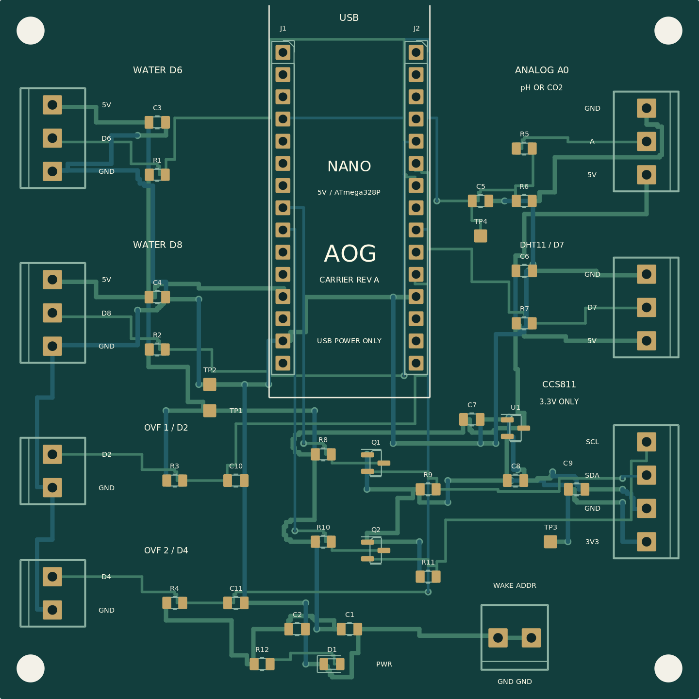

# AOG Nano carrier · revision A

One **80 × 80 mm PCB design**, used twice: plug a Sensor Kit Nano into one
assembled carrier and a Dual OVF Nano into the other. Both carriers use the
same complete parts list, so a two-board order needs only one design and one
assembly setup. Firmware selects the role; there is no hardware mode jumper.

**This is a first prototype design. It has not been manufactured or bench
tested.** Electrical design-rule and connectivity results are in
[rev-a/drc.txt](rev-a/drc.txt) and the release validation file. The water-probe
model and CCS811 breakout remain unidentified; compatibility conditions below
are part of this design, not verified facts about those modules.



## Order the assembled boards

Start with [ORDERING.md](ORDERING.md). Order **two identical, fully populated
carriers**, including the female Nano sockets and screw terminals. The package
contains fabrication Gerbers/drills, a manufacturer-specific BOM, placement
coordinates, editable KiCad files, assembly drawings and a bench-test procedure.
No order has been submitted.

The Nanos and external sensors are reused and are **not included in the
assembly BOM**. The assembler installs the carrier's parts. After delivery you
plug in the Nanos and secure the existing sensor wires in the labeled screw
terminals; factory PCB assembly does not make unidentified sensor cable
harnesses. There is no carrier soldering for you to do. A Nano without soldered
male pins needs those fitted before it can plug into the female sockets.

## Included circuitry

| Circuit | Implementation |
| --- | --- |
| Removable Nano | Two Harwin 1×15 female sockets; 2.54 mm pitch, 15.24 mm between rows |
| Water D6 and D8 | Separate three-wire connectors, each with its own fitted 4.7 kΩ pull-up to 5 V and supply decoupling |
| Overflow D2 and D4 | Dry-contact inputs with 4.7 kΩ pull-ups and 100 nF contact filters |
| Analog A0 | 1 kΩ / 100 nF low-pass filter plus 1 MΩ pull-down; one external pH or CO₂ interface |
| DHT11 D7 | Three-wire connector, fitted 4.7 kΩ data pull-up and supply decoupling |
| CCS811 | Dedicated MCP1700 3.3 V regulator, BSS138 bidirectional SDA/SCL level shifting and four 4.7 kΩ I²C pull-ups |
| CCS811 auxiliary | Two ground terminals for WAKE and ADDR where required by the breakout |
| Power / measurement | USB-derived 5 V, bulk and bypass capacitors, power LED, 5 V/GND/3.3 V/A0 test pads |
| Mounting | Four 3.2 mm non-plated holes, 73 × 73 mm between centers |

The 1 MΩ analog pull-down reduces floating values when the **interface cable**
is absent. It cannot detect an unplugged electrode on a powered Gravity pH
board. AOG's physical-connection confirmation and calibration still apply.
The analog filter introduces approximately 0.1% DC attenuation with a low
impedance source; recalibrate pH after fitting the carrier.

## Compatible hardware and power

- Classic **5 V / 16 MHz ATmega328P Nano**, including matching old-bootloader
  clones with the standard 30-pin footprint. USB points toward the top edge.
  Nano 33, RP2040, ESP32 and other 3.3 V boards are not interchangeable here.
- Water connectors expect **externally powered DS18B20** probes. Probe colors
  are not a pinout. Identify VDD, DQ and GND before connecting. A three-wire
  thermistor or RTD does not become compatible by adding a pull-up.
- CCS811 connector J9 supplies **3.3 V**, with 3.3 V I²C logic. Use a breakout
  documented to work at 3.3 V and address **0x5A**. The actual breakout brand is
  unknown; this design deliberately does not send 5 V into its I²C pins.
  A bare CCS811 chip needs its own support circuit and is not a plug-in module.
  Keep the I²C harness short (target 20 cm or less). Existing breakout pull-ups
  remain in parallel; check SDA/SCL rise times if the connection is unreliable.
- J5 accepts the **Atlas Gravity V2.1 analog pH board** on the Dual OVF carrier,
  or the **DFRobot SEN0219 v1 analog CO₂ module** on Sensor Kit. The pH electrode
  stays connected to its Gravity board. SEN0219 v2 PWM is not supported by this
  analog path or the current analog firmware profile.
- J6 expects the installed firmware's **DHT11**, not DHT22 or an I²C replacement.
- Overflow switches must be voltage-free contacts, closed to ground when safe.
  No pumps, relays, mains, 12 V or 24 V circuits attach to these connectors.

Power comes from each **Nano's USB connection**. VIN, AREF and the Nano's 3V3
pin are deliberately unconnected. There is no external power-input terminal;
do not inject power into a sensor output connector while USB is connected.
The carrier does not regulate the nominal 5 V rail: actual voltage depends on
the Nano's USB diode, cable and USB source. In particular, verify the CO₂
module's rated supply range under load. If it requires 5.0 ±0.1 V and the
Nano rail cannot deliver that, the power arrangement needs revision before
using that module; this carrier does not correct undervoltage or ADC-reference
error.

Use a conservative total external-sensor budget of **250 mA on the Nano 5 V
rail**, including the regulator input, and **100 mA maximum from the carrier's
3.3 V output**. These are design limits, not promises about an unidentified
Nano clone's USB power path. Verify its rating and the combined sensor peak
current. The 3.3 V regulator is not galvanic isolation, and the carriers are
not waterproof; mount them in a dry enclosure with cable strain relief.

## Which connector to use

Pad numbers are defined in the CAD files; follow the printed **signal labels**
when connecting wires. Right-side connector order appears reversed in a top
view because those connectors face the opposite board edge.

| Connector | Pin 1 | Pin 2 | Pin 3 | Pin 4 | Role |
| --- | --- | --- | --- | --- | --- |
| J3 · WATER D6 | 5 V / probe VDD | D6 / probe DQ | GND | — | Either |
| J4 · WATER D8 | 5 V / probe VDD | D8 / probe DQ | GND | — | Either |
| J5 · ANALOG A0 | 5 V / `+` | Analog signal / `A` | GND / `−` | — | pH on Dual OVF; analog CO₂ on Sensor Kit |
| J6 · DHT11 D7 | 5 V | DATA / D7 | GND | — | Sensor Kit |
| J7 · OVERFLOW D2 | Contact / D2 | GND | — | — | Dual OVF |
| J8 · OVERFLOW D4 | Contact / D4 | GND | — | — | Dual OVF |
| J9 · CCS811 | 3.3 V supply | GND | SDA | SCL | Sensor Kit |
| J10 · WAKE / ADDR | GND for WAKE | GND for ADDR | — | — | Sensor Kit, if the breakout needs these leads |

J9 is a labeled wire connector, **not a standardized CCS811 plug footprint**.
Map the breakout's printed pin names; do not plug a random four-pin cable in
based on color or presumed pin order. A reset pin, if exposed, follows the
breakout manufacturer's reset/pull-up requirements.

Keep the same probe-to-Arduino assignment as today. The current firmware
already checks D6 and D8 on both boards; moving the probes may require updating
their bindings in AOG. A water connector on the second board is optional, not
an instruction to install two probes on the same bus.

## Files and reproduction

- `rev-a/aog-nano-carrier-rev-a.kicad_pro`: editable KiCad project.
- `rev-a/aog-nano-carrier-rev-a.kicad_sch`: editable, embedded-symbol schematic.
- `rev-a/aog-nano-carrier-rev-a.kicad_pcb`: routed two-layer PCB.
- `rev-a/manufacturing/`: Gerber layers and separate plated/non-plated drills.
- `rev-a/bom.csv`, `positions.csv`, `assembly.pdf`: assembly inputs.
- `rev-a/board-1-to-1.pdf`: 80 × 80 mm print for a physical Nano/header fit check;
  print at actual size and measure it, with page scaling disabled.
- `rev-a/connections-*.pdf`: readable per-circuit pin references.
- `rev-a/preview.html`: offline connector guide for the two firmware roles.
- `rev-a/drc.txt`, `validation.json`: actual release-check results.
- `ASSEMBLY.md`: factory instructions and prototype bring-up.
- `SOURCES.md`: manufacturer references and footprint provenance.

On Debian 12 with KiCad 6.0.11, `kicad-footprints`, `kicad-symbols`,
`python3-numpy`, `python3-cairosvg` and `xvfb` installed:

```sh
xvfb-run -a python3 hardware/nano-carrier/tools/build.py
python3 hardware/nano-carrier/tools/documents.py
# Open the saved schematic in KiCad and run Inspect > Electrical Rules Checker.
# Save its zero-error/zero-warning report as rev-a/erc.txt and record the checked
# schematic/report hashes in erc-verification.json. Recheck after any edit.
python3 hardware/nano-carrier/tools/release.py
```

The release script refuses to package a PCB with DRC violations or unconnected
pads, or a schematic without a matching successful ERC report. Build outputs
are deterministic in electrical content;
KiCad timestamps and internal generated UUIDs may vary. No controller code,
Arduino firmware or production service needs to change to use these carriers.
